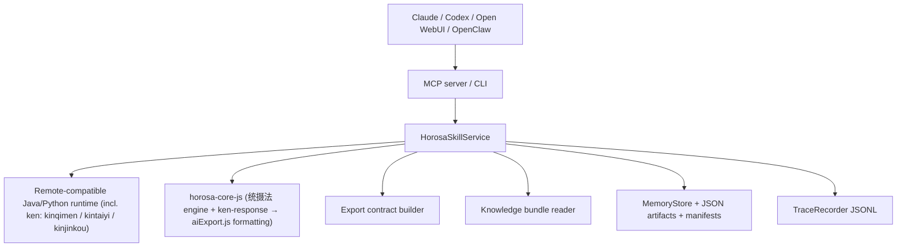

# Architecture

> 读者：维护者 / 新 agent。何时读：想看分层图与各模块职责时。路由：[`AGENTS.md`](../AGENTS.md) §0。

## 总览

Horosa Skill 由五层组成：

1. Python skill surface
2. Java / Python / Node runtime
3. Xingque export protocol layer
4. Local memory + trace
5. Bundled hover knowledge

## 结构图

## ken 计算后端（v0.6.0）

奇门遁甲（`qimen`）、太乙神数（`taiyi`）、金口诀（`jinkou`）以及三式合一（`sanshiunited`）里的奇门 + 太乙，统一由星阙的 **ken 后端**计算，与星阙桌面端同源：

- `kinqimen` / `kintaiyi` / `kinjinkou` 三个引擎挂载在本地 Python chart 服务上，对外暴露 `/qimen/pan`、`/taiyi/pan`、`/jinkou/pan`。
- `service/runners/sanshi.py` 的 `_run_{qimen,taiyi,jinkou}_tool` 先取必要 scaffold（qimen 取 nongli/jieqi，jinkou 取 liureng），再调用对应 ken 端点，把 `ken_response` 传给 `horosa-core-js`。
- `horosa-core-js` 不再自己起盘，只做 **ken-response → aiExport.js** 的格式化：用星阙的 `normalizeKinqimenData` / `normalizeBackendPan` / `normalizeKinjinkouData` 把 ken 结果叠加到本地 scaffold 上，再由 `build*SnapshotText` 输出 `export_snapshot` 所需的 section。
- ken 是唯一计算权威，JS 是表现层；若 `ken_response` 缺失或结构不完整，JS 会退回本地 scaffold 以保证不崩，但正常路径始终以 ken 为准。
- 这三个引擎已随离线 runtime 一起打包（`vendor/{kinqimen,kintaiyi,kinjinkou}`），macOS / Windows 均可断网运行；`tongshefa` 仍是纯 headless JS（无 ken 引擎）。

## 核心模块

- `src/horosa_skill/service/`（v0.41.1 起是包，导入路径不变）
  - 调度 tool、dispatch、export contract、memory write-back。`HorosaSkillService`（`__init__.py`）由 mixin 组合：`remote`（`_call_remote`）、
    `enrich`（跑完后的 `_attach_*`）、`runners/*`（每族一个模块的 `_run_*_tool`）、`api/*`（`run_tool` / `dispatch` / `hecan` / 记忆与报告）；
    纯函数层 `text/*`（快照文本）、`options_*`、`endpoints`、`export`、`envelope`、`_common`、`_context`（降级收集器 / 进度）、`_clock`
- `src/horosa_skill/runtime/`
  - `manager.py`（install / doctor / start / stop）、`identity.py`（端点归属三级证据：app 标记 + nonce → 监听进程命令行 / 映像 → 注册表 pid）、
    `registry.py`（原子状态文件）、`ports.py` / `procs.py` / `pidlock.py` / `mirrors.py`
- `src/horosa_skill/agent_guidance/`（v0.41.1 起是包，导入路径 `horosa_skill.agent_guidance.X` 不变）
  - 澄清闸策略（族策略 + 工具专属策略、`PREFLIGHT_EXEMPT_TOOLS`）——`agent_guidance.required` 从这里出；
    `base` 常量与敏感设置表 → `policies` 族策略 → `tool_table` 逐工具指引 → `contracts` 输入契约 → `catalog` 汇总 → `preflight` 闸门判定
- `src/horosa_skill/input_fields.py` + `input_normalization.py`（v0.50.0）
  - 逐字段校验：日期 / 时刻 / 时区 / 经纬度 / 性别的解析器与设置词表（`Vocabulary`；技法域词表在 `western_vocab.py` / `cn_vocab.py`），
    读得懂的写法记一条读法说明进 `warnings`，读不懂的按字段结构化拒（`tool.invalid_*` / `tool.invalid_option`）；所有技法与嵌套当事人共用
- `src/horosa_skill/engine/`：`router.py` + `intents.py`（问句先归一再按意图路由）、`time_roles.py`（每个技法要的时刻是谁的：
  natal / moment / natal+target / window / year / two_party …）、`dispatch_plan.py`（按角色逐技法拼载荷：起课类只读 `context`）、
  `hecan_select.py`（合参选技法：闸门与服务共用，按领域缺省配对）
- `src/horosa_skill/result_view.py`（v0.50.0）
  - MCP 结果的阅读视图与模型预算（纯函数，CLI 与存档不经过）：正文一遍 + 段索引 + 依据卡，超预算按段裁并给续读调用
- `src/horosa_skill/decisions/`
  - 可选云端决策层（TypeSafe Jev，默认关）：`policy.py`（scope / surfaces）、`redact.py`、`ledger.py`、`eval.py`（`contracts/jev_thresholds.json` 阈值锁）、`fake.py`（离线替身）
- `src/horosa_skill/contracts_locator.py`
  - 运行期契约定位：源码树 `contracts/` → wheel / MCPB 内副本（`jev_thresholds.json`、`technique_provenance.json`）
- `src/horosa_skill/knowledge/store.py`
- `src/horosa_skill/knowledge/retrieval.py`（归一、切词、BM25、RRF、零命中改写：内置与自备共用）
- `src/horosa_skill/knowledge/search.py`（跨语料融合与翻页）
  - 本地悬浮知识读取
- `src/horosa_skill/memory/store.py`
  - SQLite + JSON artifact + run manifest
- `src/horosa_skill/tracing.py`
  - trace / group / workflow JSONL

## 数据流

- tool run（MCP 面经 `surfaces/mcp_server.py::_gated_run`）
  - 确认标记必须是 JSON 布尔 + 逐字段校验（`precheck_arguments`，先于闸门）
  - 命主档案并入、`place` 解析成坐标与时区（闸门看解析之后的载荷）
  - 澄清闸（`agent_guidance`）：只问还没回答的问题；事实（钟点 / 性别 / 另一方 / 起课此刻）确认标记代替不了
  - runtime / local engine 执行
  - export_snapshot（export_text + sections，唯一导出契约）+ technique_card（每项设置带来源；knowledge / export 域不附）
  - trace 记录
  - artifact / manifest 写入（完整信封）
  - MCP 返回前按 `response_view` 整形（缺省阅读视图）
- dispatch
  - 问句归一（繁 / 全角 / 英文 / 拼音）→ 意图路由；多种技法都合适或不在目录时结构化拒绝
  - 闸门 = 选中技法问题的并集；按时间角色逐技法拼载荷（起课类读 `context`，推运读问句年份 / `context`），`time_basis` 写回结果
  - 共享 group_id，子工具各自 trace_id
  - 各技法结果在 MCP 上是阅读视图、共用一份预算
- hecan
  - `tools` 里的 `run_id` 原样复用，其余技法按 dispatch 同一路径起盘；没给 `tools` 按领域配一对
  - 少于两个技法算成 = 不是合参（`cross_validation: false`）；每技法带有上限的正文节选；合参自己落一条 run（`child_runs`）
